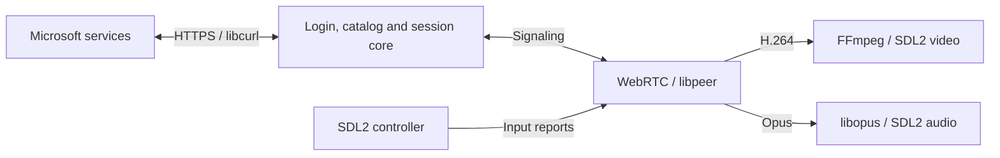

<p align="center">
  <picture>
    <source media="(prefers-color-scheme: dark)" srcset="brand/svg/orbita-horizontal.svg">
    
  </picture>
</p>

<h1 align="center">Orbita R36S/H</h1>

<p align="center">
  <strong>Cloud gaming. Native C. A handheld worth experimenting with.</strong><br>
  An experimental Xbox Cloud Gaming client for R36S/H handhelds running ArkOS.
</p>

<p align="center">
  <a href="docs/port-r36sh/README.md"></a>
  
  
  <a href="LICENSE"></a>
</p>

<p align="center">
  <strong>English</strong> · <a href="README.pt-BR.md" lang="pt-BR">Português brasileiro</a>
</p>

<p align="center">
  <a href="#download-and-installation">Download</a> ·
  <a href="#project-status">Status</a> ·
  <a href="#quick-start">Quick start</a> ·
  <a href="#architecture">Architecture</a> ·
  <a href="#contributing">Contribute</a> ·
  <a href="#documentation">Docs</a>
</p>

Orbita brings Microsoft sign-in, the cloud catalog and game streaming directly
to the handheld. This fork adapts the original Orbita Xbox 360 core to Linux/ARM,
using SDL2, libcurl, WebRTC, FFmpeg and Opus. Authorize your Microsoft account
from a phone or PC, then browse and launch games on the device. No Orbita website
account, invitation or beta key is required.

## Download and installation

Open [Releases](https://github.com/D1Alexandre/orbita-R36SH/releases) for the
ready-to-install **R36S/H ARM64 ZIP**, then follow the
[installation tutorial](docs/INSTALL.md). It covers copying files to the games
card, Microsoft sign-in, controls, updates and troubleshooting. Choose the
application ZIP under Assets; the automatic Source code archives are for developers.

## Why work on Orbita?

- **Make constrained hardware do more.** Work on decoder throughput, bounded
  media queues, frame pacing and controller response on a small Linux handheld.
- **Explore the whole streaming path.** Follow a session from HTTPS signaling
  through ICE, DTLS-SRTP and SCTP to H.264 video, Opus audio and input reports.
- **Start on your desktop.** Build the Linux client, run the SDL tests and use
  a local Pion peer to exercise media and input without a Microsoft account.

## Project status

**Experimental, with real hardware evidence.** A HOT WHEELS session delivered
720p frames on an R36S, and the user reported smoother play after a decoder fix.
The Linux target is **0.2.3**; the latest recorded on-device installation is
**0.2.2**, with deployment of the search update still pending.

| Area | Current evidence |
|---|---|
| Microsoft sign-in and catalog | Validated on the handheld, including saved-token reuse. |
| Catalog search | Full catalog, cached names, on-screen keyboard and normalized search; covered by local menu tests. |
| Sessions and WebRTC | Integrated into the Linux target; a real cloud session delivered video on the device. |
| H.264 video | FFmpeg software decoding and SDL YUV presentation; hardware acceleration is open work. |
| Opus audio and input | Validated with a local Pion peer; audible sound and every physical control still need explicit on-device confirmation. |
| Performance and recovery | FPS, end-to-end latency, temperature, audiovisual sync and network-loss recovery need further validation. |
| Fortnite | Search shortcut implemented; launch remains unvalidated after `NoEntitlement` and `OfferingAccessDenied` responses for the tested account. |

The default video request is **720p / 30 fps / 1000 kbps**. The server determines
the received format; these settings are not measured playback guarantees.
Catalog visibility does not grant access to a game: Microsoft authorizes each
session according to the account's access and service availability.

Read the [port status](docs/port-r36sh/README.md),
[hardware streaming evidence](docs/port-r36sh/STREAMING-2026-11-13.md) and
[search validation](docs/port-r36sh/SEARCH-2026-11-20.md) for details.

## Quick start

### Build and test on Linux

Use a C11 compiler, CMake 3.16+, SDL2 2.0.10+ and libcurl 7.58+.
On Debian/Ubuntu, install the build and test dependencies:

```sh
sudo apt-get update
sudo apt-get install -y \
  build-essential cmake pkg-config git python3 openssl ca-certificates \
  libsdl2-dev libcurl4-openssl-dev libavformat-dev libavcodec-dev \
  libavutil-dev libswscale-dev libopus-dev
```

Clone the repository, build the pinned WebRTC dependencies, then build and test
the client. Run these commands in a Linux shell:

```sh
git clone https://github.com/D1Alexandre/orbita-R36SH.git
cd orbita-R36SH

OUTROOT="$PWD/build/webrtc" bash deps/webrtc-linux/build.sh
cmake -S app/r36s -B build/r36s -DCMAKE_BUILD_TYPE=Release \
  -DORBITA_WEBRTC_ROOT="$PWD/build/webrtc/host"
cmake --build build/r36s -j2
(cd build/r36s && ctest --output-on-failure)
```

The dependency script downloads pinned sources on its first run. The default
CTest suite covers catalog search, storage, clocks, HTTPS, SDL, the launcher and
the session protocol without signing in to Microsoft.

```sh
./build/r36s/orbita --diagnose     # Inspect version, architecture and libraries
./build/r36s/orbita --input-test   # Identify controller buttons and axes
./build/r36s/orbita --windowed     # Open the desktop client and sign-in screen
```

### Build a package for the handheld

From the repository root, use Docker Buildx with native or emulated ARM64
execution support:

```sh
docker buildx build --platform linux/arm64 -f app/r36s/Dockerfile \
  --target package --output type=local,dest=dist/r36s-arm64 .
```

Check the device's architecture and runtime libraries with
[`tools/r36-probe.sh`](tools/r36-probe.sh). Copy `Orbita.sh` and the `orbita/`
directory from `dist/r36s-arm64/` into the active card's `/roms/ports/` or
`/roms2/ports/`, then launch Orbita from EmulationStation. The package uses the
device's SDL and graphics drivers; compatibility depends on the exact ArkOS image.

See the [Linux target guide](app/r36s/README.md) for runtime checks, executable
permissions, installation details and diagnostic commands.

### Exercise streaming without a cloud account

With the Linux build above, **Go 1.23+** and **FFmpeg CLI with libx264** installed,
run the local integration test from the repository root:

```sh
ORBITA_PEER_BIN="$PWD/build/peer_pion"
(cd app/h264play/hosttest/webrtc/peer_pion && go build -o "$ORBITA_PEER_BIN" .)
python3 app/r36s/tests/test_stream.py build/r36s/orbita "$ORBITA_PEER_BIN"
```

This test negotiates real local WebRTC, sends synthetic H.264 and Opus, checks
rendered pixels with SDL dummy drivers and verifies input reports at the peer.
It does not contact Microsoft or read account tokens. To include it in CTest,
configure CMake with `-DORBITA_PION_PEER="$ORBITA_PEER_BIN"`.

## Architecture



The SDL main loop owns rendering and controller polling. Separate workers handle
HTTPS signaling, UDP/WebRTC and H.264 decoding. The Linux platform layer supplies
storage, clocks, entropy and transport while reusing the original login and
session core. Media queues are bounded to limit backlog.

| Path | Start here for |
|---|---|
| [`app/r36s/`](app/r36s/README.md) | Linux application, catalog UI, streaming, tests and ArkOS launcher. |
| [`platform/linux/`](platform/linux/) | Linux storage, clocks, libcurl HTTPS and WebRTC UDP adapters. |
| [`app/h264play/source/`](app/h264play/source/) | Shared authentication, catalog, session and WebRTC code; original Xbox implementation. |
| [`app/h264play/hosttest/`](app/h264play/hosttest/) | Host tests and the local Pion peer. |
| [`deps/webrtc-linux/`](deps/webrtc-linux/README.md) | Pinned WebRTC dependency build and patch provenance. |
| [`tools/`](tools/) | Device probes, ARM64 packaging, capture and release utilities. |
| [`docs/port-r36sh/`](docs/port-r36sh/README.md) | Port status, hardware findings and validation records. |
| [`research/`](research/) | Decoder, synchronization, protocol and platform experiments. |
| [`brand/`](brand/BRAND.md) | Existing logos, palette and brand assets. |

The repository also retains the original [`web/`](web/README.md) and
[`telemetry/`](telemetry/README.md) components. The Linux client signs in directly
with Microsoft and does not require the Orbita website account flow.

## Contributing

C, Linux, multimedia, networking and handheld testing all have useful entry
points. Choose a focused problem, describe how to reproduce it and include the
evidence needed to assess the change.

| Area | Useful contributions | Entry point |
|---|---|---|
| Video | Measure decoder cost, frame pacing and queue drops; investigate Rockchip acceleration. | [`stream.c`](app/r36s/src/stream.c), [`video_test.c`](app/r36s/src/video_test.c) |
| Audio and input | Confirm sound, audiovisual sync, buttons and analog axes on hardware revisions. | [`stream.c`](app/r36s/src/stream.c), [`main.c`](app/r36s/src/main.c) |
| Session recovery | Reproduce stalls, queue cancellation, reconnects and clean session shutdown. | [`session core`](app/h264play/source/session/), [`Linux WebRTC`](platform/linux/xc_webrtc_linux.c) |
| Catalog and UI | Improve search, keyboard navigation and readability on the 640×480 canvas. | [`catalog_view.c`](app/r36s/src/catalog_view.c), [`menu tests`](app/r36s/tests/menu_test.c) |
| Packaging and docs | Check ArkOS compatibility, improve setup instructions and keep both README languages aligned. | [`Dockerfile`](app/r36s/Dockerfile), [`launcher`](app/r36s/packaging/Orbita.sh), [`port docs`](docs/port-r36sh/README.md) |

For a pull request, explain the problem, the resulting behavior and how you
validated it. Distinguish desktop or emulated results from physical-device
results. For hardware reports, include the device revision, ArkOS image, build
version, network setup, reproduction steps and relevant `STAT` log lines.

The launcher writes `orbita/logs/last-run.log` inside the ports directory.
Share only relevant, reviewed excerpts; keep tokens, Microsoft sign-in codes
and account files out of issues and pull requests.

## Documentation

- [Download and install on ArkOS](docs/INSTALL.md)
- [Linux build, installation, controls and troubleshooting](app/r36s/README.md)
- [Port status and next hardware checks](docs/port-r36sh/README.md)
- [Initial validation and device findings](docs/port-r36sh/VALIDATION-2026-11-13.md)
- [Streaming architecture, evidence and current limits](docs/port-r36sh/STREAMING-2026-11-13.md)
- [Full catalog behavior](docs/port-r36sh/CATALOG-2026-11-16.md)
- [Search, controller keyboard and Fortnite access findings](docs/port-r36sh/SEARCH-2026-11-20.md)
- [Architecture decision records](docs/adr/)
- [Third-party components and licenses](THIRD_PARTY.md)

## Xbox 360 heritage

<details>
<summary>Original target and legacy build instructions</summary>

The original Orbita client targets **Xbox 360 RGH/JTAG**, with legacy base
**0.21.44**, XeLL Reloaded v0.993+ and wired networking. Its libxenon ELF source
is retained here as the foundation for the Linux port. The upstream XEX variant
is outside this repository. PowerPC/XEX executables do not run on the R36S/H.

On a Linux host with the Xenon toolchain and FFmpeg Xenon dependencies prepared:

```sh
source scripts/env.sh
deps/build-mbedtls-xenon.sh
deps/build-opus-xenon.sh
deps/webrtc-xenon/build.sh xenon
make -C app/h264play BETA=0
```

The output is `app/h264play/h264play.elf32`, booted through XeLL as `xenon.elf`.
See the [toolchain ADR](docs/adr/ADR-001-toolchain.md),
[H.264 decoder ADR](docs/adr/ADR-007-h264-decoder-base.md),
[access/build guide](app/h264play/BETA-GATE.md) and
[Makefile](app/h264play/Makefile) for prerequisites and build options.
No Microsoft XDK is required. The original Xbox project's site is
<https://x360.pistatrack.com>.

</details>

## License and affiliation

Licensed under [GPL-3.0](LICENSE). See [THIRD_PARTY.md](THIRD_PARTY.md) for bundled
components and their licenses.

Orbita is an independent, unofficial project, not affiliated with, endorsed by
or sponsored by Microsoft. Xbox, Xbox 360, Xbox Cloud Gaming and Game Pass are
Microsoft trademarks. You use your own Microsoft account and must have access
to the games you launch.
