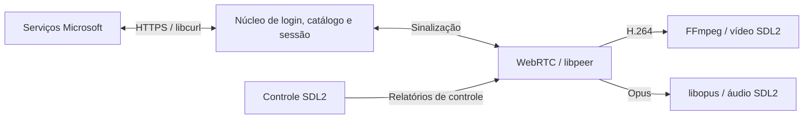

<p align="center">
  <picture>
    <source media="(prefers-color-scheme: dark)" srcset="brand/svg/orbita-horizontal.svg">
    
  </picture>
</p>

<h1 align="center">Orbita R36S/H</h1>

<p align="center">
  <strong>Jogos na nuvem. C nativo. Um portátil para experimentar.</strong><br>
  Cliente experimental de Xbox Cloud Gaming para R36S/H com ArkOS.
</p>

<p align="center">
  <a href="docs/port-r36sh/README.md"></a>
  
  
  <a href="LICENSE"></a>
</p>

<p align="center">
  <a href="README.md" lang="en">English</a> · <strong>Português brasileiro</strong>
</p>

<p align="center">
  <a href="#download-e-instalação">Download</a> ·
  <a href="#estado-do-projeto">Status</a> ·
  <a href="#comece-por-aqui">Primeiros passos</a> ·
  <a href="#arquitetura">Arquitetura</a> ·
  <a href="#como-contribuir">Contribua</a> ·
  <a href="#documentação">Documentação</a>
</p>

O Orbita leva login Microsoft, catálogo da nuvem e streaming de jogos diretamente
ao portátil. Este fork adapta o núcleo original do Orbita para Xbox 360 ao
Linux/ARM, usando SDL2, libcurl, WebRTC, FFmpeg e Opus. Autorize sua conta Microsoft
pelo celular ou PC e, depois, navegue e inicie os jogos no aparelho. Não é preciso
ter conta no site Orbita, convite ou chave beta.

## Download e instalação

Abra as [Releases](https://github.com/D1Alexandre/orbita-R36SH/releases) para
baixar o **ZIP R36S/H ARM64 pronto para instalar** e siga o
[tutorial de instalação](docs/INSTALL.pt-BR.md). Ele explica a cópia para o cartão,
login Microsoft, controles, atualização e solução de problemas. Escolha o ZIP
do aplicativo em Assets; os arquivos automáticos Source code são para desenvolvedores.

## Por que desenvolver no Orbita?

- **Faça mais com um hardware limitado.** Trabalhe no desempenho do decoder,
  em filas de mídia com limite, no ritmo de apresentação dos frames e na resposta
  dos controles de um pequeno portátil Linux.
- **Explore o caminho completo do streaming.** Acompanhe a sessão desde a
  sinalização HTTPS, passando por ICE, DTLS-SRTP e SCTP, até vídeo H.264,
  áudio Opus e envio dos controles.
- **Comece pelo desktop.** Compile o cliente Linux, execute os testes SDL e use
  um peer Pion local para exercitar mídia e controles sem uma conta Microsoft.

## Estado do projeto

**Experimental, com evidências no aparelho real.** Uma sessão de HOT WHEELS
entregou frames 720p no R36S, e o usuário relatou maior fluidez após uma correção
do decoder. O alvo Linux está na versão **0.2.3**; a instalação mais recente
registrada no aparelho é a **0.2.2**, com o envio da atualização de busca ainda
pendente.

| Área | Evidência atual |
|---|---|
| Login Microsoft e catálogo | Validados no portátil, incluindo reutilização do token salvo. |
| Busca no catálogo | Catálogo completo, nomes em cache, teclado na tela e busca normalizada; cobertos pelos testes locais do menu. |
| Sessões e WebRTC | Integrados ao alvo Linux; uma sessão real da nuvem entregou vídeo no aparelho. |
| Vídeo H.264 | Decodificação por software com FFmpeg e apresentação SDL YUV; aceleração de hardware é trabalho em aberto. |
| Áudio Opus e controles | Validados com um peer Pion local; som audível e cada controle físico ainda precisam de confirmação explícita no aparelho. |
| Desempenho e recuperação | FPS, latência total, temperatura, sincronização audiovisual e recuperação após perda de rede precisam de mais validação. |
| Fortnite | Atalho de busca implementado; abertura ainda não validada após respostas `NoEntitlement` e `OfferingAccessDenied` para a conta testada. |

O pedido padrão de vídeo é **720p / 30 fps / 1000 kbps**. O servidor determina o
formato recebido; esses parâmetros não são garantias de desempenho medido.
Exibir um jogo no catálogo não concede acesso: a Microsoft autoriza cada sessão
conforme o acesso da conta e a disponibilidade do serviço.

Consulte o [estado do port](docs/port-r36sh/README.md), as
[evidências de streaming no aparelho](docs/port-r36sh/STREAMING-2026-11-13.md) e a
[validação da busca](docs/port-r36sh/SEARCH-2026-11-20.md) para mais detalhes.

## Comece por aqui

### Compile e teste no Linux

Use um compilador C11, CMake 3.16+, SDL2 2.0.10+ e libcurl 7.58+.
No Debian/Ubuntu, instale as dependências de compilação e teste:

```sh
sudo apt-get update
sudo apt-get install -y \
  build-essential cmake pkg-config git python3 openssl ca-certificates \
  libsdl2-dev libcurl4-openssl-dev libavformat-dev libavcodec-dev \
  libavutil-dev libswscale-dev libopus-dev
```

Clone o repositório, compile as dependências WebRTC com versões fixadas e, depois,
compile e teste o cliente. Execute estes comandos em um shell Linux:

```sh
git clone https://github.com/D1Alexandre/orbita-R36SH.git
cd orbita-R36SH

OUTROOT="$PWD/build/webrtc" bash deps/webrtc-linux/build.sh
cmake -S app/r36s -B build/r36s -DCMAKE_BUILD_TYPE=Release \
  -DORBITA_WEBRTC_ROOT="$PWD/build/webrtc/host"
cmake --build build/r36s -j2
(cd build/r36s && ctest --output-on-failure)
```

O script de dependências baixa fontes com versões fixadas na primeira execução.
A suíte CTest padrão cobre busca no catálogo, armazenamento, relógios, HTTPS,
SDL, launcher e protocolo de sessão sem fazer login na Microsoft.

```sh
./build/r36s/orbita --diagnose     # Mostra versão, arquitetura e bibliotecas
./build/r36s/orbita --input-test   # Identifica botões e eixos do controle
./build/r36s/orbita --windowed     # Abre o cliente e a tela de login no desktop
```

### Gere um pacote para o portátil

Na raiz do repositório, use Docker Buildx com suporte a execução ARM64 nativa
ou emulada:

```sh
docker buildx build --platform linux/arm64 -f app/r36s/Dockerfile \
  --target package --output type=local,dest=dist/r36s-arm64 .
```

Confira a arquitetura e as bibliotecas do aparelho com
[`tools/r36-probe.sh`](tools/r36-probe.sh). Copie `Orbita.sh` e a pasta `orbita/`
de `dist/r36s-arm64/` para `/roms/ports/` ou `/roms2/ports/` no cartão ativo e
abra Orbita pelo EmulationStation. O pacote usa a SDL e os drivers gráficos do
aparelho; a compatibilidade depende da imagem exata do ArkOS.

Veja o [guia do alvo Linux](app/r36s/README.md) para conferir bibliotecas,
permissões de execução, detalhes de instalação e comandos de diagnóstico.

### Exercite o streaming sem conta na nuvem

Com a build Linux acima, **Go 1.23+** e **FFmpeg CLI com libx264** instalados,
execute o teste integrado local a partir da raiz do repositório:

```sh
ORBITA_PEER_BIN="$PWD/build/peer_pion"
(cd app/h264play/hosttest/webrtc/peer_pion && go build -o "$ORBITA_PEER_BIN" .)
python3 app/r36s/tests/test_stream.py build/r36s/orbita "$ORBITA_PEER_BIN"
```

Esse teste negocia WebRTC local real, envia H.264 e Opus sintéticos, confere os
pixels renderizados com drivers SDL dummy e verifica os relatórios de controle
no peer. Não acessa a Microsoft nem lê tokens da conta. Para incluí-lo no CTest,
configure o CMake com `-DORBITA_PION_PEER="$ORBITA_PEER_BIN"`.

## Arquitetura



O loop principal SDL cuida da renderização e da leitura dos controles. Workers
separados tratam sinalização HTTPS, UDP/WebRTC e decodificação H.264. A camada de
plataforma Linux fornece armazenamento, relógios, entropia e transporte,
reaproveitando o núcleo original de login e sessão. As filas de mídia têm limite
para controlar o acúmulo.

| Caminho | Comece aqui para |
|---|---|
| [`app/r36s/`](app/r36s/README.md) | Aplicativo Linux, interface do catálogo, streaming, testes e launcher ArkOS. |
| [`platform/linux/`](platform/linux/) | Adaptadores Linux de armazenamento, relógios, HTTPS com libcurl e UDP do WebRTC. |
| [`app/h264play/source/`](app/h264play/source/) | Código compartilhado de autenticação, catálogo, sessão e WebRTC; implementação original do Xbox. |
| [`app/h264play/hosttest/`](app/h264play/hosttest/) | Testes no host e peer Pion local. |
| [`deps/webrtc-linux/`](deps/webrtc-linux/README.md) | Build das dependências WebRTC com versões fixadas e origem dos patches. |
| [`tools/`](tools/) | Probes do aparelho, empacotamento ARM64, captura e ferramentas de release. |
| [`docs/port-r36sh/`](docs/port-r36sh/README.md) | Estado do port, descobertas do hardware e registros de validação. |
| [`research/`](research/) | Experimentos com decoder, sincronização, protocolos e plataforma. |
| [`brand/`](brand/BRAND.md) | Logos, paleta e arquivos da identidade visual existente. |

O repositório também preserva os componentes originais de
[`web/`](web/README.md) e [`telemetry/`](telemetry/README.md). O cliente Linux
entra diretamente com a Microsoft e não depende do fluxo de conta do site Orbita.

## Como contribuir

C, Linux, multimídia, redes e testes em portáteis têm pontos de entrada úteis.
Escolha um problema específico, descreva como reproduzi-lo e inclua as evidências
necessárias para avaliar a mudança.

| Área | Contribuições úteis | Ponto de entrada |
|---|---|---|
| Vídeo | Medir custo do decoder, ritmo dos frames e descartes de filas; investigar aceleração Rockchip. | [`stream.c`](app/r36s/src/stream.c), [`video_test.c`](app/r36s/src/video_test.c) |
| Áudio e controles | Confirmar som, sincronização audiovisual, botões e analógicos nas revisões do hardware. | [`stream.c`](app/r36s/src/stream.c), [`main.c`](app/r36s/src/main.c) |
| Recuperação de sessão | Reproduzir travas, cancelamento de fila, reconexões e encerramento correto da sessão. | [`núcleo de sessão`](app/h264play/source/session/), [`WebRTC Linux`](platform/linux/xc_webrtc_linux.c) |
| Catálogo e interface | Melhorar busca, navegação pelo teclado e legibilidade no canvas 640×480. | [`catalog_view.c`](app/r36s/src/catalog_view.c), [`testes do menu`](app/r36s/tests/menu_test.c) |
| Pacotes e documentação | Conferir compatibilidade com ArkOS, melhorar a instalação e manter os READMEs alinhados nos dois idiomas. | [`Dockerfile`](app/r36s/Dockerfile), [`launcher`](app/r36s/packaging/Orbita.sh), [`documentação do port`](docs/port-r36sh/README.md) |

No pull request, explique o problema, o comportamento resultante e como validou
a mudança. Diferencie resultados no desktop ou em emulação dos obtidos no
aparelho físico. Nos relatos de hardware, inclua revisão do dispositivo, imagem
do ArkOS, versão da build, configuração de rede, passos para reproduzir e linhas
`STAT` relevantes do log.

O launcher grava `orbita/logs/last-run.log` dentro da pasta de ports.
Compartilhe apenas trechos relevantes e revisados; mantenha tokens, códigos de
login Microsoft e arquivos da conta fora de issues e pull requests.

## Documentação

- [Baixar e instalar no ArkOS](docs/INSTALL.pt-BR.md)
- [Build Linux, instalação, controles e solução de problemas](app/r36s/README.md)
- [Estado do port e próximas verificações no aparelho](docs/port-r36sh/README.md)
- [Validação inicial e descobertas do dispositivo](docs/port-r36sh/VALIDATION-2026-11-13.md)
- [Arquitetura do streaming, evidências e limites atuais](docs/port-r36sh/STREAMING-2026-11-13.md)
- [Comportamento do catálogo completo](docs/port-r36sh/CATALOG-2026-11-16.md)
- [Busca, teclado pelo controle e descobertas sobre acesso ao Fortnite](docs/port-r36sh/SEARCH-2026-11-20.md)
- [Registros de decisões de arquitetura](docs/adr/)
- [Componentes de terceiros e licenças](THIRD_PARTY.md)

## Origem no Xbox 360

<details>
<summary>Alvo original e instruções de build do legado</summary>

O cliente original do Orbita tem como alvo o **Xbox 360 RGH/JTAG**, com base
legada **0.21.44**, XeLL Reloaded v0.993+ e rede cabeada. O código ELF com libxenon
foi preservado como base do port Linux. A variante XEX do projeto original está
fora deste repositório. Executáveis PowerPC/XEX não rodam no R36S/H.

Em um host Linux com a toolchain Xenon e as dependências FFmpeg Xenon preparadas:

```sh
source scripts/env.sh
deps/build-mbedtls-xenon.sh
deps/build-opus-xenon.sh
deps/webrtc-xenon/build.sh xenon
make -C app/h264play BETA=0
```

A saída é `app/h264play/h264play.elf32`, iniciada pelo XeLL como `xenon.elf`.
Consulte o [ADR da toolchain](docs/adr/ADR-001-toolchain.md),
[ADR do decoder H.264](docs/adr/ADR-007-h264-decoder-base.md),
[guia de acesso/build](app/h264play/BETA-GATE.md) e
[Makefile](app/h264play/Makefile) para pré-requisitos e opções de compilação.
Não é necessário usar o Microsoft XDK. O site do projeto original para Xbox é
<https://x360.pistatrack.com>.

</details>

## Licença e afiliação

Licenciado sob [GPL-3.0](LICENSE). Consulte [THIRD_PARTY.md](THIRD_PARTY.md) para
os componentes incluídos e suas licenças.

O Orbita é um projeto independente e não oficial, sem afiliação, endosso ou
patrocínio da Microsoft. Xbox, Xbox 360, Xbox Cloud Gaming e Game Pass são marcas
da Microsoft. Você usa sua própria conta Microsoft e precisa ter acesso aos
jogos que iniciar.
